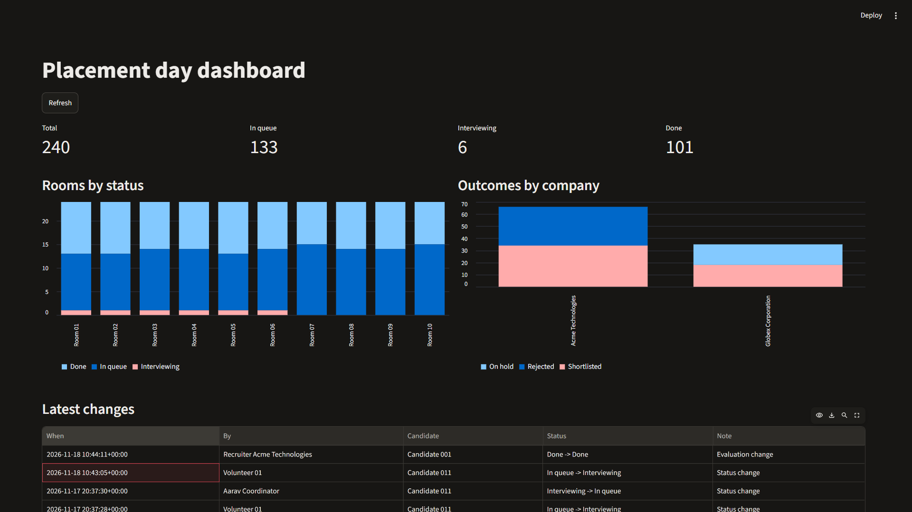
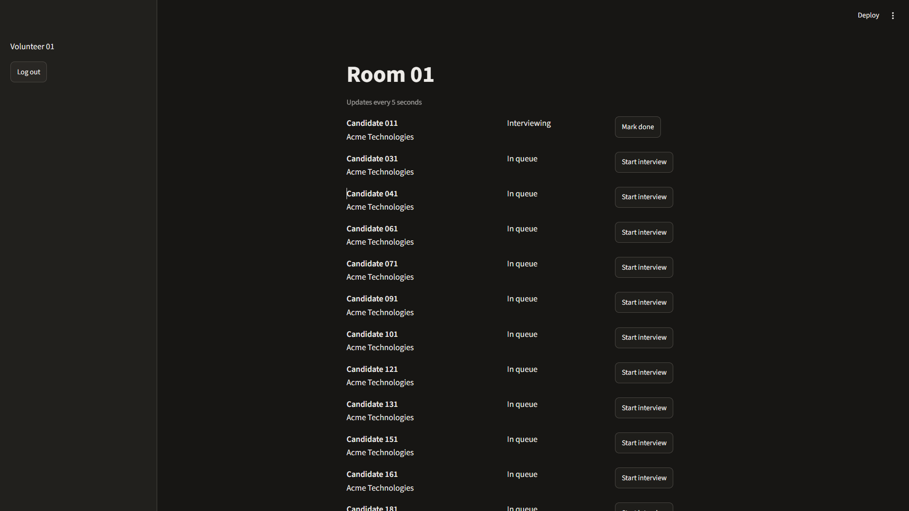

**PostgreSQL · Supabase · Streamlit · Python** — live at
https://placement-ops-aditya.streamlit.app

On placement day, companies interview students in different rooms...
I worked on a Power BI and Excel version of this with a team. The files are gone, so I rebuilt it from scratch **in one day** with sample data, this time putting the rules in the database instead of trusting people to edit cells correctly.

## What the database enforces
- A room can't be booked twice for the same time
- One interview at a time per room, and per candidate
- Status goes in queue, interviewing, done. Only the coordinator can undo
- Every change is logged with who made it
- Volunteers touch only their own room, recruiters only their own company

## Concurrency
Two volunteers can tap at the same moment in the same room.
`scripts/race_test.py` proves only one succeeds — no double-booking, even under a race.

